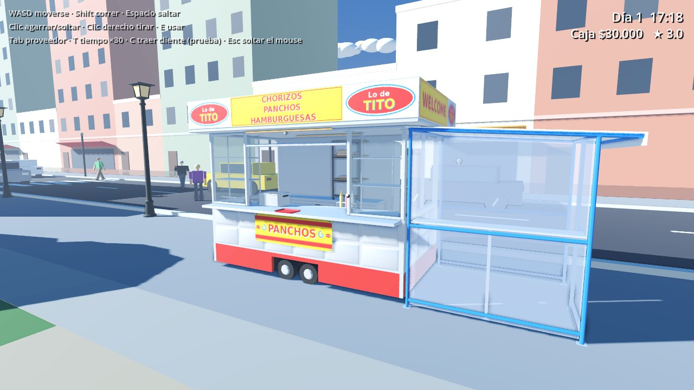
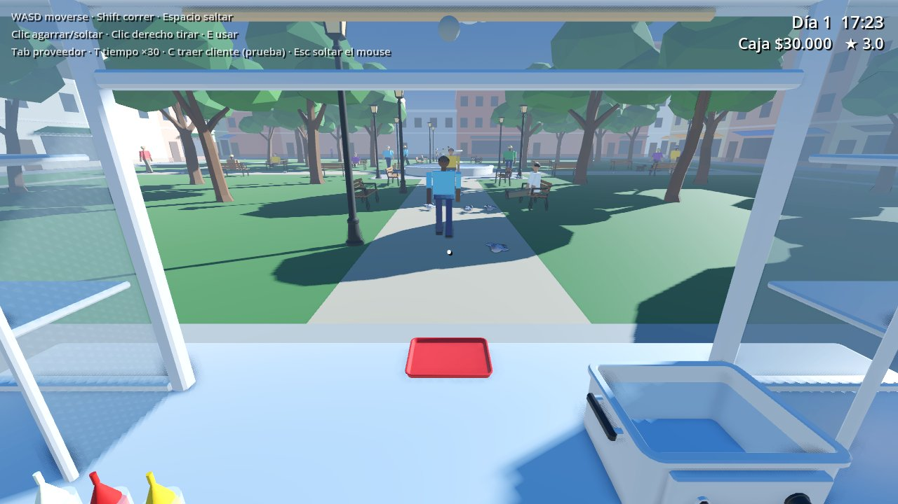
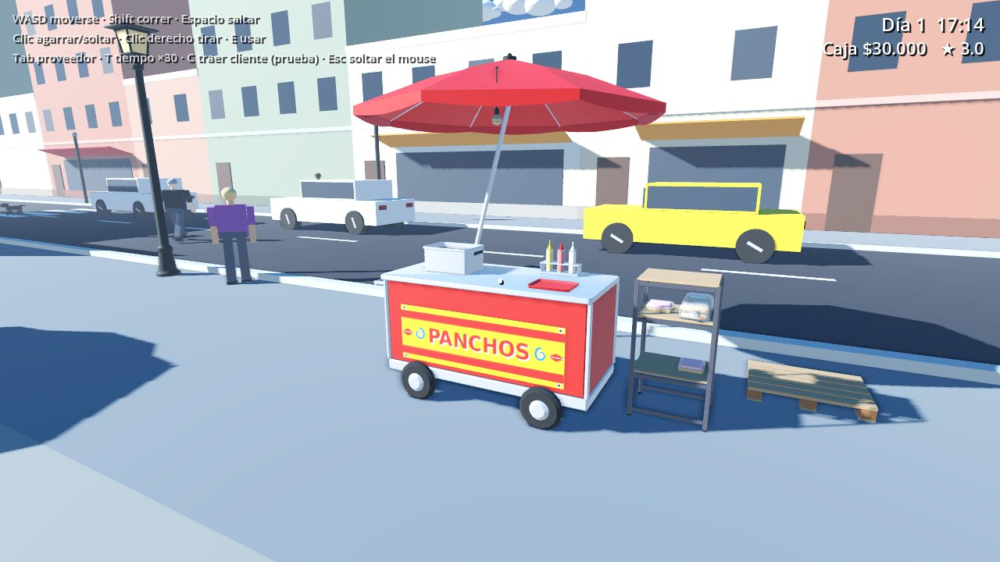
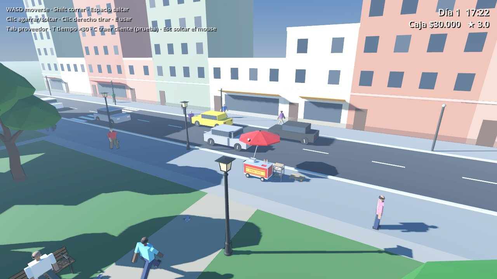
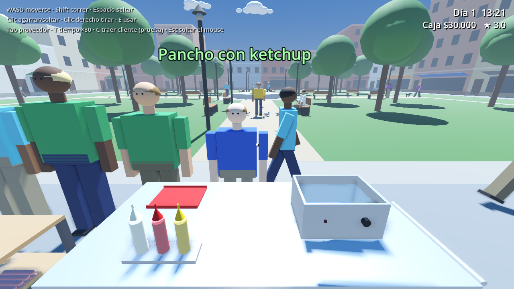
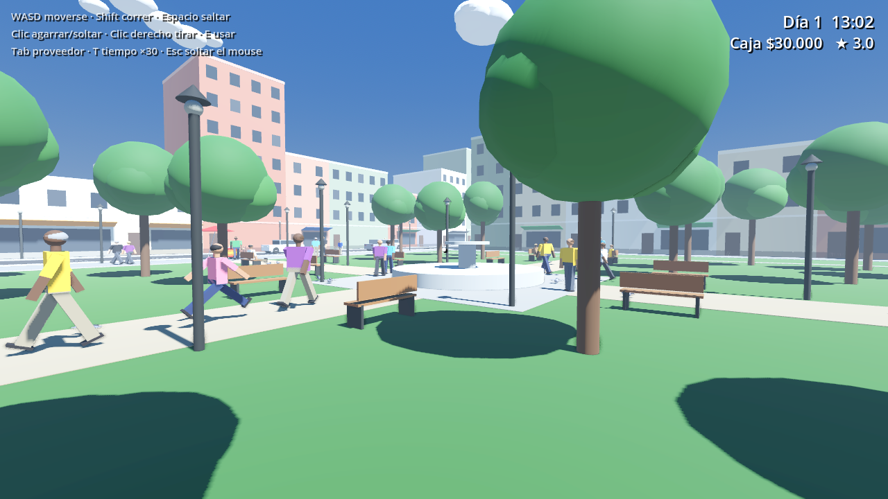
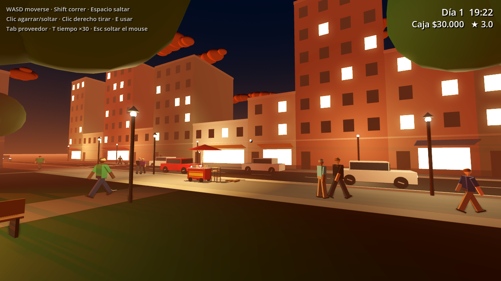
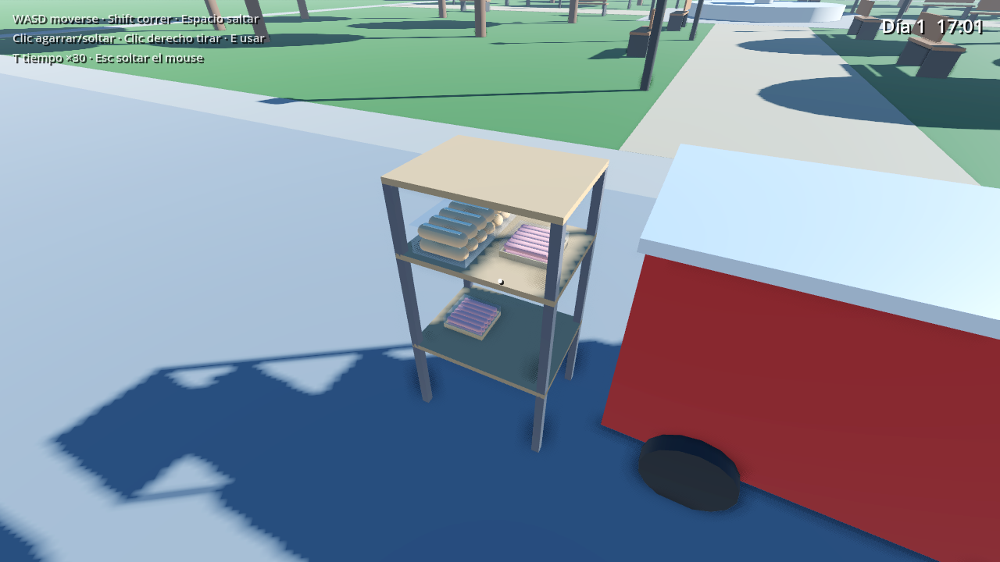

# Fast Food Simulator

Simulador de carrito de comida rápida (panchos, hamburguesas, choripanes) en 3D con
física real, frente a una plaza. Hecho con **Godot 4.7** y **Rust** (godot-rust 0.5).

> Estado y próximas tareas: [`docs/ROADMAP.md`](docs/ROADMAP.md).
> Desde [SPEC-025](docs/specs/025-modelos.md) el carrito, sus accesorios, la comida y la plaza
> usan modelos 3D hechos con la [guía de modelado](docs/arte/guia-modelado-3d.md).

| | |
|---|---|
|  |  |
|  |  |
|  |  |
|  |  |
|  |  |

*(Capturas con el renderizador de compatibilidad; en Godot con Vulkan se ve mejor.)*

## Descargar y jugar

En [**Releases**](https://github.com/nazarenoalt/fast-food-simulator/releases/latest) está
el juego listo para Windows, macOS y Linux: bajá el `.zip` de tu sistema, descomprimilo y
abrilo.

- **Windows:** `FastFoodSimulator.exe`. Si aparece "Windows protegió tu PC", tocá
  *Más información → Ejecutar de todas formas* (el juego no está firmado).
- **macOS:** la primera vez, clic derecho sobre `Fast Food Simulator.app` → *Abrir*.
- **Linux:** `./FastFoodSimulator.x86_64`.

Los `.zip` los arma la acción **Builds**, que se corre a mano (pestaña Actions → Builds →
*Run workflow* sobre `main`). Para publicar una versión nueva, cambiá el número del archivo
`VERSION` (por ejemplo a `0.3.0`), subilo a `main` y corré Builds: crea la Release.

## Cómo se trabaja: specs primero

Este proyecto sigue *spec-driven development* ([SPEC-000](docs/specs/000-proceso.md)):

1. Toda funcionalidad empieza como una spec en [`docs/specs/`](docs/specs/) con requisitos
   numerados (`REQ-COC-03`) y criterios de aceptación (`CA-COC-01`).
2. Cada requisito tiene un test o, si depende de Godot, un comentario `// REQ-...` en el
   código que lo cumple.
3. `cargo test` incluye un test de **trazabilidad** que falla si algún requisito no está
   citado en el código (o si el código cita uno que no existe).
4. `tools/prueba_humo.sh` abre el juego sin pantalla y verifica los criterios de aceptación
   de integración (cocinar, sacar del depósito, armar un pancho, luces de noche).

## Requisitos

- [Rust](https://rustup.rs) 1.94 o más nuevo.
- [Godot 4.7](https://godotengine.org/download) (versión estándar, no la de .NET).

## Compilar y jugar desde el código

```bash
cd rust
cargo build
```

Después abrí `godot/project.godot` con Godot y apretá **F5** (o "Ejecutar proyecto").
La primera vez Godot tarda un poco en importar el proyecto.

Cada vez que cambies código Rust, volvé a correr `cargo build`; Godot recarga la librería.

Controles, cómo atender clientes y cómo agregar contenido: [`docs/jugar.md`](docs/jugar.md).

## Tests

```bash
cd rust && cargo test                          # reglas + trazabilidad
GODOT=/ruta/a/godot tools/prueba_humo.sh       # prueba de humo en el motor
```

## Contribuir

Specs primero, un PR por etapa, ramas `tipo/TASK-0000-slug` y títulos `tipo (modulo): descripción`.
Las reglas completas (y el mapa del repo) están en [`CLAUDE.md`](CLAUDE.md).

## Notas técnicas

- Física: **Jolt** (incluida en Godot). Las unidades guardadas en el depósito no tienen
  física hasta que se sacan, para que un depósito lleno no haga lento el juego.
- Los modelos son `.glb` hechos en Blender siguiendo la [guía de modelado 3D](docs/arte/guia-modelado-3d.md)
  y la [lista de modelos](docs/arte/lista-de-modelos.md); las formas simples de los datos son el respaldo
  (ver [ROADMAP](docs/ROADMAP.md) para Git LFS).
- Al exportar, agregá `data/*.ron` en "Filtros para exportar archivos que no son recursos".
