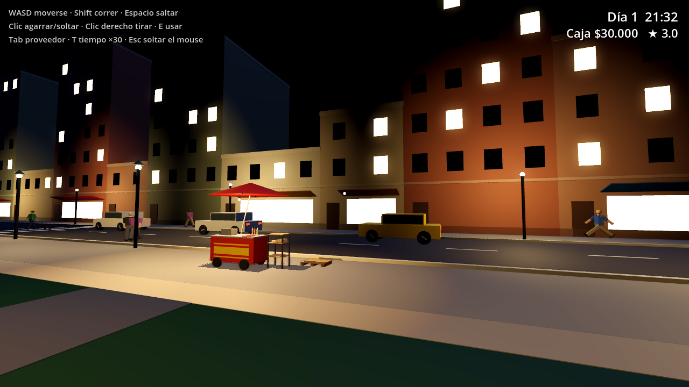

# Carrito

Simulador de carrito de comida rápida (panchos, hamburguesas, choripanes) en 3D con
física real, frente a una plaza. Hecho con **Godot 4.7** y **Rust** (godot-rust 0.5).

> Estado: **etapa 2**: además de cocinar y armar panchos, llegan clientes que hacen fila,
> piden y pagan; hay caja, reputación, proveedor y aderezos. Alrededor, una ciudad con
> gente, autos, palomas, nubes y cielo con sol y luna.
> Ver [`docs/hoja-de-ruta.md`](docs/hoja-de-ruta.md).

| | |
|---|---|
|  |  |
|  |  |
|  |  |

*(Capturas con el renderizador de compatibilidad; en Godot con Vulkan se ve mejor.)*

## Descargar y jugar

En [**Releases**](https://github.com/nazarenoalt/fast-food-simulator/releases/latest) está
el juego listo para Windows, macOS y Linux: bajá el `.zip` de tu sistema, descomprimilo y
abrilo.

- **Windows:** `Carrito.exe`. Si aparece "Windows protegió tu PC", tocá
  *Más información → Ejecutar de todas formas* (el juego no está firmado).
- **macOS:** la primera vez, clic derecho sobre `Carrito.app` → *Abrir*.
- **Linux:** `./Carrito.x86_64`.

Cada cambio que se sube arma estos `.zip` automáticamente (acción **Builds**). Para
publicar una versión nueva: `git tag v0.3.0 && git push origin v0.3.0`.

## Cómo se trabaja: specs primero

Este proyecto sigue *spec-driven development* ([SPEC-000](docs/specs/000-proceso.md)):

1. Toda funcionalidad empieza como una spec en [`docs/specs/`](docs/specs/) con requisitos
   numerados (`REQ-COC-03`) y criterios de aceptación (`CA-COC-01`).
2. Cada requisito tiene un test o, si depende de Godot, un comentario `// REQ-...` en el
   código que lo cumple.
3. `cargo test` incluye un test de **trazabilidad** que falla si algún requisito no está
   citado en el código (o si el código cita uno que no existe).
4. `tools/prueba_humo.sh` abre el juego sin pantalla y verifica los criterios de aceptación
   de integración (cocinar, sacar del depósito, armar un pancho, luces de noche).

## Requisitos

- [Rust](https://rustup.rs) 1.94 o más nuevo.
- [Godot 4.7](https://godotengine.org/download) (versión estándar, no la de .NET).

## Compilar y jugar desde el código

```bash
cd rust
cargo build
```

Después abrí `godot/project.godot` con Godot y apretá **F5** (o "Ejecutar proyecto").
La primera vez Godot tarda un poco en importar el proyecto.

Cada vez que cambies código Rust, volvé a correr `cargo build`; Godot recarga la librería.

### Controles

| Tecla | Acción |
|---|---|
| W A S D | Moverse |
| Mouse | Mirar |
| Shift | Correr |
| Espacio | Saltar |
| Clic izquierdo | Agarrar / soltar |
| Clic derecho | Tirar lo que tenés en la mano |
| E | Usar: prender el hervidor, sacar del depósito, poner aderezo (con el pancho en la mano), recargar un pomo (con el repuesto en la mano) |
| Tab | Panel del proveedor (comprar mercadería) |
| T | Tiempo ×30 (para ver el atardecer rápido) |
| C | Traer un cliente al instante (para probar) |
| Esc | Soltar el mouse |

**Para atender a un cliente:**
1. E sobre el hervidor para prenderlo.
2. E sobre el paquete de salchichas del estante y soltá la salchicha en el agua.
3. Esperá a que esté cocida (el cartel lo dice y cambia de color).
4. Sacá un pan de la bolsa, dejalo en la mesada y soltá la salchicha encima: se arma el pancho.
5. Con el pancho en la mano, mirá un pomo y apretá E para ponerle el aderezo que pidió el
   cliente (está en el globo sobre su cabeza).
6. Dejá el pancho en la **bandeja roja**: el cliente lo agarra, paga y se va comiendo.

**Cuando se acaba algo:** Tab abre el proveedor. Lo que comprás llega en una hora de juego
a un pallet al lado del carrito; llevá el paquete a un lugar libre del estante y queda guardado.

## Tests

```bash
cd rust && cargo test                          # reglas + trazabilidad
GODOT=/ruta/a/godot tools/prueba_humo.sh       # prueba de humo en el motor
```

## Estructura

```
docs/specs/        ← las specs (qué tiene que pasar)
docs/arte/         ← guía de modelado 3D, paleta y lista de modelos a hacer
rust/core/         ← reglas puras, sin Godot: cocción, depósito, carrito, reloj, plaza
rust/game/         ← nodos de Godot en Rust: jugador, comida, hervidor, carrito, HUD…
godot/data/        ← contenido en archivos .ron: productos, bloques, accesorios, carritos
godot/scenes/      ← escena principal y escena de prueba de humo
tools/             ← scripts (prueba de humo)
```

### Agregar contenido sin tocar código

- **Un carrito nuevo:** copiá un archivo de `godot/data/carritos/` y cambiale id, medidas
  y anclajes.
- **Un accesorio:** agregalo en `godot/data/accesorios.ron` (categoría, forma, función).
- **Cambiar tu carrito:** editá `godot/data/carrito_jugador.ron` (base, color, qué va en
  cada anclaje y el stock inicial). Si algo no encaja, el juego muestra el error arriba
  del carrito.

## Notas técnicas

- Física: **Jolt** (incluida en Godot). Las unidades guardadas en el depósito no tienen
  física hasta que se sacan, para que un depósito lleno no haga lento el juego.
- Los modelos son piezas simples (cajas, cilindros) definidas en los datos; se van a
  reemplazar por modelos de Blender (`.glb`) más adelante, siguiendo la
  [guía de modelado 3D](docs/arte/guia-modelado-3d.md) y la [lista de modelos](docs/arte/lista-de-modelos.md). Cuando haya modelos, conviene
  activar Git LFS para los archivos pesados.
- Al exportar el juego, agregá `data/*.ron` en "Filtros para exportar archivos que no son
  recursos", para que se incluyan los datos.
