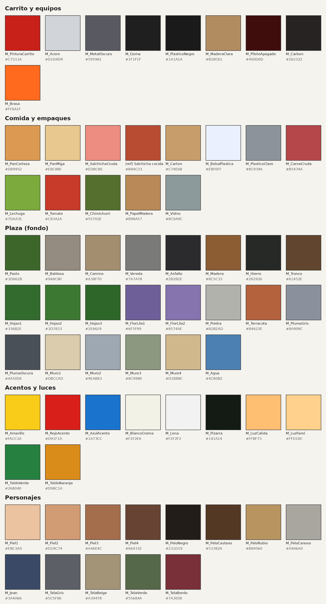

# Guía de modelado 3D

Estado: **Vigente (v1, estilo low poly)**

Esta guía define cómo se ven y cómo se arman **todos** los modelos 3D del juego. La idea es
que cualquier modelo nuevo, lo haga quien lo haga (una persona en Blender o un script),
parezca parte del mismo mundo. Si un modelo no cumple algo de acá, se corrige el modelo o se
cambia la guía primero (igual que con las specs: primero la regla, después el contenido).

La lista de qué hay que modelar está en [`lista-de-modelos.md`](lista-de-modelos.md).

---

## 1. La idea visual en una frase

> **Un carrito de comida de barrio, en una plaza argentina, al atardecer: low poly limpio,
> cálido y legible, donde lo que se toca se destaca y el fondo acompaña.**

### Los cinco pilares

| # | Pilar | Qué significa en la práctica |
|---|---|---|
| 1 | **Silueta primero** | Cada objeto se reconoce solo por su contorno, aun en sombra o de noche. Si al pintarlo todo negro no se entiende qué es, falta forma. |
| 2 | **Low poly, no tosco** | Pocas caras, pero bien puestas: bordes biselados, proporciones correctas, nada de cajas sin terminar. "Simple" no es "sin cuidado". |
| 3 | **Color plano, sin texturas** | Cada parte es un color liso de la [paleta](#4-color-y-materiales). Nada de fotos, ruido ni texturas pintadas (salvo carteles con texto, ver 4.5). |
| 4 | **Lo que se toca, se destaca** | Comida, herramientas y el carrito usan colores vivos y cálidos. La plaza (pasto, piso, árboles) usa colores apagados. Así el jugador encuentra rápido lo importante. |
| 5 | **Escala real** | 1 unidad = 1 metro, y los objetos miden lo que miden en la vida real. El juego tiene física y se agarran cosas con la mano: si un pan es gigante, se nota. |

### Lo que NO buscamos

- Realismo fotográfico, texturas escaneadas, desgaste o suciedad pintada.
- Estilo "caricatura" exagerado (cabezas enormes, objetos inflados, contornos negros).
- Voxel / pixel art / estilo "bloques de Minecraft".
- Marcas reales (gaseosas, aderezos, cervezas). Se inventan nombres propios del juego.

### Referencia del estado actual

Las capturas de [`docs/capturas/`](../capturas/) muestran el juego hecho con piezas simples
(cajas, cilindros). Los modelos nuevos **reemplazan** esas piezas, respetando sus medidas,
colores y ubicación. Si hoy algo mide 0,17 m, el modelo mide 0,17 m.

---

## 2. Escala, medidas y orientación

### 2.1 Unidades

- **1 unidad de Blender = 1 metro.** Escena en *Metric*, *Unit Scale* = 1,0.
- Medidas de referencia del mundo (no cambiarlas sin cambiar las specs):

| Referencia | Medida | De dónde sale |
|---|---|---|
| Jugador (alto total) | 1,75 m | REQ-JUG-05 |
| Ojos del jugador | 1,65 m | REQ-JUG-05 |
| Mostrador del carrito | 0,95 m (carro grande: 1,00 m) | `godot/data/carritos/*.ron` |
| Banco de plaza (asiento) | 0,45 m | `plaza.rs` |
| Farol | 3,6 m | `plaza.rs` |
| Pan de pancho | 0,17 × 0,045 × 0,055 m | `productos.ron` |

- Siempre tené en la escena de trabajo una **silueta humana de 1,75 m** y un **cubo de
  0,95 m** (alto de mostrador) para comparar. El archivo
  `arte/biblioteca/referencias.blend` (ver sección 9) los trae listos.

### 2.2 Grosor mínimo

Las piezas finas reales (chapa, tela, cables) desaparecen o parpadean en pantalla. Por eso:

| Tipo de objeto | Grosor mínimo de cualquier pieza |
|---|---|
| Objetos de mano (comida, utensilios) | 3 mm |
| Equipos sobre el mostrador | 5 mm |
| Muebles, carrito, accesorios grandes | 1 cm |
| Mobiliario urbano, edificios | 2 cm |

Excepción: cables y sogas pueden ser un cilindro de 6 lados de 4 mm de radio o más.

### 2.3 Orientación (importante)

En el juego, el **frente** de un objeto (el lado que mira al cliente / a la plaza) es **+Z**
de Godot, y el lado del vendedor es −Z (así ya funcionan los anclajes: el telón va en
`frente`, con Z positivo; la perilla del hervidor mira al vendedor, −Z).

En Blender esto se traduce así (el exportador glTF hace la conversión):

| Dirección | Blender | Godot |
|---|---|---|
| Arriba | +Z | +Y |
| **Frente (cliente)** | **−Y** (lo que ves con la vista *Front*, tecla 1 del teclado numérico) | **+Z** |
| Atrás (vendedor) | +Y | −Z |
| Derecha (vista desde el frente) | +X | +X |

Regla simple: **en la vista *Front* de Blender tenés que ver la cara que ve el cliente.**

### 2.4 Origen (punto de pivote)

| Tipo de objeto | Dónde va el origen |
|---|---|
| Comida y objetos que se agarran | En el **centro** del objeto (coincide con el centro de su colisión en `productos.ron`). |
| Accesorios del carrito | En el **punto de apoyo**: centro de la base, a la altura donde se apoya (Z = 0). Es el punto que coincide con el anclaje. |
| Bases de carrito | Centro del **cuerpo pintado** (el ancho × profundidad del `.ron`), a nivel del piso. No el centro de la caja envolvente: la mesada corrida y la manija la descentran. |
| Mobiliario de la plaza, árboles, faroles | Centro de la base, a nivel del piso. En árboles y faroles: la base del tronco o de la columna (aunque la copa se incline). |
| Bloques de stock (bolsa, bandeja) | Centro de la base del cuerpo del paquete, a nivel de la superficie donde se apoya (aunque el nudo de la bolsa sobresalga). |
| Luces colgantes (foco) | En el punto de donde cuelga (arriba). |
| Piezas que flotan respecto de su anclaje (telón, sombrilla, techos) | En el anclaje, aunque la pieza quede corrida (el telón empieza a 0,31 m; el paño de la sombrilla va corrido 0,62 m en X). |

**Piezas con caras borradas a propósito** (lo apoyado en el piso, lo pegado a otra pieza, puntas de
caño): el chequeo de normales de `comun.revisar()` puede dar negativo estando bien. Se reemplaza con
`comun.chequeo_normales_cerrado()`, que cierra los huecos antes de medir.

**Objetos que no son simétricos.** `comun.revisar()` mide el origen contra el centro de la caja
envolvente. Si el objeto no es simétrico respecto de su origen (perilla de un solo lado, manija,
árbol inclinado, nudo de la bolsa), ese chequeo falla aunque el origen esté bien. En ese caso
**no se mueve el modelo**: el script reemplaza esa línea de la revisión por un chequeo propio
que dice qué se midió (ej. "batea centrada", "base del tronco en el origen").

Antes de exportar: **aplicar rotación y escala** (Ctrl+A → *All Transforms*). El objeto
tiene que quedar con rotación 0 y escala 1.

---

## 3. Geometría

### 3.1 Presupuesto de triángulos

Son topes, no metas. Si se llega a la forma con menos, mejor.

| Categoría | Triángulos (máx.) | Ejemplos |
|---|---|---|
| Comida chica | 300 | salchicha, pan, medallón, chorizo |
| Comida armada | 600 | pancho, hamburguesa, choripán |
| Empaques y bloques de stock | 400 | bolsa de panes, bandeja de salchichas |
| Utensilios y objetos chicos | 500 | pinza, servilletero, pomo de aderezo |
| Equipos de cocina | 1.500 | hervidor, plancha, parrilla |
| Accesorios medianos | 1.000 | estante, pizarra, cerco, foco |
| Accesorios grandes | 2.000 | sombrilla, carpa, toldo |
| Base de carrito | 3.000 | barra chica, mediana, carro grande |
| Mobiliario urbano | 800 | banco, farol, tacho de basura |
| Árbol | 1.200 | cada variante |
| Fuente / estructuras grandes de la plaza | 2.500 | fuente, juegos de plaza |
| Personaje (NPC) | 3.000 | cliente, paseante |
| Edificio / fachada | 2.000 | por fachada |

### 3.2 Cantidad de lados de cilindros y esferas

Para que todo el juego tenga la misma "resolución", la cantidad de lados depende del tamaño:

| Radio del cilindro | Lados |
|---|---|
| Menos de 1,5 cm (salchicha, cables, varillas) | 8 |
| 1,5 a 5 cm (pan, pomos, patas, perillas) | 12 |
| 5 a 25 cm (ruedas, ollas, base de sombrilla) | 16 |
| 25 cm a 1 m (fuente chica, mesas redondas) | 24 |
| Más de 1 m (sombrilla, fuente grande) | 32 |

El radio de un cilindro es el de sus **caras planas**, no el de sus aristas, y una cara plana va
hacia abajo (o hacia el frente). Si no, una rueda de radio 0,15 queda 3 mm en el aire y una
salchicha sale más fina que su colisión. En `piezas.cilindro()` eso es `radio_a_caras=True`
en ambas funciones, `piezas.cilindro()` y `piezas.colision_cilindro()` (por defecto miden en las
aristas, para no cambiar los modelos ya hechos). En modelos nuevos, usar `radio_a_caras=True`.

Esferas: *UV Sphere* con la mitad de anillos que de lados (ej. 12 × 6), o *Ico Sphere* de 1 o
2 subdivisiones. Las copas de los árboles son la excepción: formas irregulares de 30 a 80
caras, sin simetría perfecta.

### 3.3 Bordes biselados

Ninguna caja queda con aristas perfectamente filosas: el bisel es lo que hace que el low poly
se vea "terminado" y que la luz dibuje los bordes.

- Usar el modificador **Bevel** con **1 segmento** (2 en piezas redondeadas grandes, como el
  borde de la mesada).
- Ancho del bisel según el objeto:

| Tamaño del objeto | Ancho de bisel |
|---|---|
| Objetos de mano | 2–3 mm |
| Equipos de mostrador | 4–6 mm |
| Muebles, carrito, accesorios | 1–1,5 cm |
| Mobiliario urbano, edificios | 2–3 cm |

- Excepción: comida y telas (lona, telón) no llevan bisel; ya son formas suaves.
- Piezas finas: en una tabla o barra de menos de 8 cm, el bisel va en **alrededor de un cuarto
  de su grosor** (ej. 1 cm en una tabla de banco de 4 cm), aunque la tabla de arriba diga más.

### 3.4 Sombreado (suave vs. facetado)

- **Objetos duros** (metal, madera, plástico, carrito): *Shade Auto Smooth* /
  *Smooth by Angle* a **30°**. Las caras planas se ven planas y los biseles se ven redondeados.
- **Comida y formas orgánicas** (pan, salchicha, hojas de lechuga, medallón): sombreado
  **suave** completo. Con poca geometría, el sombreado suave es lo que las hace "apetitosas".
- **Árboles, piedras y terreno**: sombreado **facetado** (*Flat*). Es el toque low poly del fondo.

### 3.5 Nivel de detalle: qué se modela y qué no

Pensar en tres niveles:

1. **Forma principal** (siempre): el volumen que da la silueta. Cuerpo del carrito, caja del
   hervidor, paño de la sombrilla.
2. **Piezas secundarias** (siempre, si se ven a 2 m): manijas, ruedas, perillas, patas,
   bordes de la mesada, varillas de la sombrilla, corte del pan.
3. **Detalle fino** (nunca como geometría): tornillos chicos, costuras, texto chico, rayas
   del metal. Si hace falta, va como color o como cartel (4.5).

**Regla de los 2 metros:** si algo no se distingue desde 2 m de distancia (la distancia desde
donde el jugador ve el mostrador), no se modela. Excepción: lo que el jugador agarra con la
mano (se ve a ~40 cm) puede tener un poco más de detalle, dentro de su presupuesto.

### 3.6 Topología y limpieza

- Sin caras duplicadas, sin vértices sueltos, sin caras internas ocultas
  (*Merge by Distance* antes de exportar).
- Normales hacia afuera (*Recalculate Outside*). Revisar con *Face Orientation*: todo azul.
- Las caras que **nunca** se ven (la base de algo apoyado en el piso, el lado de un cartel
  pegado a una pared) se borran.
- Triángulos y cuadrados están bien; evitar polígonos de más de 4 lados en caras curvas.
- Piezas que se mueven o que el código toca van como **objetos separados** (ver 6.2).

---

## 4. Color y materiales

### 4.1 La paleta



Todos los colores salen de esta paleta. Están tomados de los colores que el juego ya usa, para
que los modelos encajen con lo que existe. Se cargan en Blender con el campo **Hex** del color
base (el hex ya está en el espacio de color correcto; no copiar los números de 0 a 1).

| Material | Hex | Metálico | Rugosidad | Uso |
|---|---|---|---|---|
| **Carrito y equipos** |||||
| `M_PinturaCarrito` | `#C7211A` | 0 | 0,6 | Cuerpo del carrito. **El juego cambia este color** (REQ-CAR-09). |
| `M_Acero` | `#D1D4D9` | 0,6 | 0,35 | Mesada, hervidor, manijas, servilletero, caños. |
| `M_MetalOscuro` | `#595961` | 0,6 | 0,4 | Estructuras de estantes, parrilla. |
| `M_Goma` | `#1F1F1F` | 0 | 0,9 | Ruedas, burletes, patas antideslizantes. |
| `M_PlasticoNegro` | `#1A1A1A` | 0 | 0,5 | Perillas, mangos, cables. |
| `M_MaderaClara` | `#B28C61` | 0 | 0,8 | Tablas de estantes, tablas de picar. |
| `M_PilotoApagado` | `#400D0D` | 0 | 0,4 | Luces piloto apagadas. **El juego las enciende.** |
| `M_Carbon` | `#262322` | 0 | 0,95 | Carbón apagado. |
| `M_Brasa` | `#FF6A1F` | 0 | 0,8 | Brasas encendidas (emisión). **El juego cambia la intensidad según el fuego.** |
| **Comida y empaques** |||||
| `M_PanCorteza` | `#DB9952` | 0 | 0,75 | Exterior de todos los panes. |
| `M_PanMiga` | `#E8C88E` | 0 | 0,8 | Corte / interior de los panes. |
| `M_SalchichaCruda` | `#ED8C80` | 0 | 0,6 | Salchicha. **El juego cambia este color al cocinar.** |
| *(ref.) salchicha cocida* | `#B84C33` | — | — | Solo referencia: lo pone el código. |
| `M_Carton` | `#C79E6B` | 0 | 0,9 | Bandejas, cajas de cartón. |
| `M_BolsaPlastica` | `#EBF0FF` | 0 | 0,3 | Bolsas. Transparente (alfa 0,35). |
| `M_PlasticoClaro` | `#8C939A` | 0 | 0,15 | Plástico translúcido de pomos y film que deja ver lo de adentro con su color (alfa 0,15). El gris es a propósito: con transparencia, un color claro "lava" lo de atrás; este casi no suma y se ve incoloro. |
| `M_CarneCruda` | `#B5474A` | 0 | 0,65 | Medallón y chorizo crudos. **El juego cambia este color al cocinar.** |
| `M_Lechuga` | `#7DAA3C` | 0 | 0,7 | Hoja de lechuga. |
| `M_Tomate` | `#C83A2A` | 0 | 0,5 | Rodaja de tomate. |
| `M_Chimichurri` | `#55702E` | 0 | 0,6 | Chimichurri. |
| `M_PapelMadera` | `#B98A57` | 0 | 0,9 | Bolsas de papel de panadería y de carbón. |
| `M_Vidrio` | `#8C9A9C` | 0 | 0,1 | Frascos. Transparente (alfa 0,2); gris medio a propósito, como `M_PlasticoClaro`. |
| **Plaza (fondo, colores apagados)** |||||
| `M_Pasto` | `#3D662B` | 0 | 1,0 | Pasto. |
| `M_Baldosa` | `#948C80` | 0 | 0,9 | Baldosas de la plaza. |
| `M_Camino` | `#A38F70` | 0 | 0,95 | Caminos de tierra / polvo de ladrillo. |
| `M_Vereda` | `#7A7A78` | 0 | 0,9 | Vereda, cordón. |
| `M_Asfalto` | `#2B2B2E` | 0 | 0,95 | Calle. |
| `M_Madera` | `#8C5C33` | 0 | 0,85 | Bancos, cercos, madera a la intemperie. |
| `M_Hierro` | `#262926` | 0,5 | 0,6 | Faroles, patas de bancos, rejas. |
| `M_Tronco` | `#61452E` | 0 | 1,0 | Troncos y ramas. |
| `M_Hojas1/2/3` | `#336B2E` `#3D7833` `#2E6629` | 0 | 0,9 | Copas de árboles (mezclar los tres por árbol). |
| `M_FlorLila1/2` | `#6F5F99` `#8574AE` | 0 | 0,9 | Copa de los jacarandás en flor (mezclar los dos, con algo de `M_Hojas2`). Lila apagado: se lee como jacarandá sin gritar. |
| `M_Piedra` | `#B2B2AD` | 0 | 0,9 | Fuente, monumentos, bordes de cantero. |
| `M_Terracota` | `#B4623E` | 0 | 0,9 | Macetas de barro cocido. |
| `M_PlumaGris` `M_PlumaOscura` | `#8A909C` `#4A5058` | 0 | 0,85 / 0,8 | Palomas: cuerpo y cabeza. |
| `M_Muro1..4` | `#DBCCAD` `#9EA8B3` `#8C9980` `#D1B88C` | 0 | 0,9 | Paredes de las fachadas (los mismos tonos que usa hoy `ciudad.rs`). |
| `M_Agua` | `#4C80B2` | 0 | 0,1 | Agua de la fuente (alfa 0,7). |
| **Acentos y luces** |||||
| `M_Amarillo` | `#FACC1A` | 0 | 0,6 | Telones, carteles, detalles de marca. |
| `M_RojoAcento` | `#D91F1A` | 0 | 0,6 | Sombrillas, franjas de telones. |
| `M_AzulAcento` | `#1A73CC` | 0 | 0,6 | Franjas, detalles. |
| `M_BlancoCrema` | `#F2F2E6` | 0 | 0,7 | Telas claras, franjas, papel. |
| `M_Lona` | `#F2F2F2` | 0 | 0,9 | Techo de carpas, toldos. |
| `M_Pizarra` | `#141A14` | 0 | 0,9 | Pizarras. |
| `M_LuzCalida` | `#FFBF73` | 0 | 0,5 | Lamparitas del carrito (emisión). |
| `M_LuzFarol` | `#FFD18C` | 0 | 0,5 | Faroles de la plaza (emisión). |
| `M_ToldoVerde` `M_ToldoNaranja` | `#268040` `#D98C1A` | 0 | 0,8 | Toldos de los negocios de la ciudad (junto con RojoAcento y AzulAcento). |
| **Personajes** |||||
| `M_Piel1/2/3/4` | `#EBC3A0` `#D19C74` `#A46E4C` `#664332` | 0 | 0,6 | Tonos de piel, de claro a oscuro. **El juego elige uno por persona.** |
| `M_PeloNegro` `M_PeloCastano` `M_PeloRubio` `M_PeloCanoso` | `#231D19` `#533824` `#B89560` `#A9A6A0` | 0 | 0,8 | Pelo y cejas. **El juego elige uno por persona.** |
| `M_Jean` | `#3A4A66` | 0 | 0,9 | Pantalones de jean. |
| `M_TelaGris` `M_TelaBeige` `M_TelaVerde` `M_TelaBordo` | `#5C5F66` `#A39478` `#55684A` `#7A3038` | 0 | 0,9 | Ropa de colores apagados (remeras, camisas, pantalones, zapatillas). La ropa también puede usar los acentos y `M_BlancoCrema`. |

### 4.2 Reglas de color

1. **No inventar colores.** Si hace falta uno nuevo, se agrega primero a esta tabla y a
   `tools/arte/paleta.json`, con su nombre `M_...`. Después se regeneran `paleta.png`
   (`tools/arte/generar_paleta.py`) y la biblioteca (`tools/blender/biblioteca.py`), y recién ahí se usa.
2. **Fondo apagado, primer plano vivo.** Lo de la plaza usa colores de baja saturación (salvo los juegos infantiles, que pueden usar los acentos). Los
   colores saturados (rojo, amarillo, azul) quedan para el carrito, la comida, los carteles y
   las sombrillas.
3. **Ni blanco ni negro puros.** Nada más claro que `#F7F7F7` ni más oscuro que `#141414`;
   con la luz del atardecer los extremos "se queman".
4. **Máximo 4 materiales por objeto** (6 en bases de carrito, equipos de cocina, vehículos, fachadas y personajes). Más
   materiales = objeto más ruidoso y más lento de dibujar.
5. **Variantes por color, no por modelo.** La sombrilla roja y la rayada son el mismo modelo
   con distintos materiales. Mismo criterio para todo lo que venga en colores.

### 4.3 Materiales en Blender

- Un único nodo **Principled BSDF** por material, sin texturas, con los valores de la tabla.
- Los nombres de material son **exactamente** los de la tabla (`M_Acero`, no `Acero.001`).
  Los materiales vienen de `arte/biblioteca/materiales.blend`: se *linkean* o *appendean*,
  no se crean a mano.
- Transparencias (bolsas, agua, vidrio): *Blend Mode* = *Alpha Blend* y el valor de alfa de la
  tabla. Solo en las piezas que lo necesitan, nunca en todo el objeto.
- Luces (lamparitas, pilotos, carteles luminosos): la parte que brilla es un **objeto aparte**
  con su material de emisión. **No** se exportan luces de Blender: las luces reales las crea el
  juego (grupo `luces_noche`, REQ-CAR-06, REQ-MUN-02).

### 4.4 Colores que cambia el código

Algunas piezas cambian de color durante el juego. Esas piezas van como **objeto separado** y
con su material propio, para que el código las encuentre por nombre:

| Pieza | Material | Qué hace el código |
|---|---|---|
| Cuerpo pintado del carrito | `M_PinturaCarrito` | Pone el color elegido por el jugador. |
| Salchicha (sola o dentro del pancho) | `M_SalchichaCruda` | Le cambia el color según la cocción. |
| Medallón, chorizo (etapa 4) | `M_CarneCruda` | Ídem. |
| Brasas de la parrilla (etapa 4) | `M_Brasa` | Cambia la intensidad según el fuego. |
| Luz piloto del hervidor | `M_PilotoApagado` | Se enciende al prender. |
| Agua del hervidor | `M_Agua` | Cambia color y transparencia con la temperatura. |

### 4.5 Texto, logos y carteles

- El texto **no se modela** letra por letra. Va en una imagen chica (`.png`, 256 o 512 px)
  aplicada sobre la cara del cartel, **solo con colores de la paleta** y dibujada sin
  suavizado (cada píxel es un color de la paleta).
- Si el cartel cubre toda la cara, la imagen es **opaca**, con fondo de un color de la paleta:
  así no hay transparencias ni problemas de orden de dibujo. Fondo transparente solo si el
  cartel va pegado sobre otra superficie que se tiene que ver.
- El material del cartel se llama `T_<id>` (ej. `T_telon_panchos`). Es el único material que no
  sale de la biblioteca; la revisión lo acepta si su imagen usa solo colores de la paleta
  (`revisar_cartel` en `tools/blender/modelos/pizarra_precios.py`). La imagen va en
  `godot/modelos/<familia>/texturas/<id>.png` y embebida en el `.glb` (`exportar_glb(..., uvs=True)`).
- Lo que el juego puede cambiar (precios, menú) **no se pinta**: las pizarras van en blanco,
  con la superficie para escribir como `pieza_pizarra` y su cara mapeada (UV de 0 a 1), para que
  el código escriba encima. Solo va pintado el texto fijo (el nombre en un telón, en un cartel).
- Tipografía de los carteles del carrito: de trazo grueso, estilo "letrero pintado a mano"
  de carrito porteño (filete simplificado como guarda, sin detalle fino).
- Nada de marcas reales: los nombres se inventan (ej. "Panchos El Turco", "Mostaza Doña Rosa").

---

## 5. Estilo por familia de objetos

### 5.1 Comida

- La comida es la "estrella": formas redondeadas, sombreado suave, colores cálidos.
- Proporciones reales (ver `productos.ron`), pero con formas un poco más "llenas" que la
  realidad: un pan levemente inflado se lee mejor que uno chato.
- El interior (miga, corte) es un color más claro que el exterior (`M_PanMiga`).
- **Panes abiertos, como los de panadería:** el corte va a lo largo casi hasta la base, las
  dos mitades se separan hacia afuera y la miga se ve en las caras de adentro. Nada de una
  franja clara "pintada" arriba. El fondo del corte tiene la forma del relleno (la salchicha,
  el chorizo), para que quede **hundido** entre las dos mitades. Referencia: `pan_pancho`.
- Los productos armados (pancho, hamburguesa) son las **mismas piezas** que los ingredientes,
  combinadas. El pancho = el modelo del pan + el de la salchicha, no un modelo nuevo.

### 5.2 Carrito y accesorios

- Inspiración: carritos de panchos y choripán de plaza y de cancha. Chapa pintada, mesada de
  acero, ruedas de goma, sombrilla.
- Volúmenes rectos con biseles generosos, esquinas redondeadas en la mesada.
- Las partes de acero son las únicas brillantes (metálico); todo lo demás es mate.
- Cada accesorio tiene que verse bien **solo** y **en cualquier base** de carrito: no debe
  depender de la forma de un carrito en particular.

### 5.3 Equipos de cocina

- Cuerpos de acero (`M_Acero`) con perillas y mangos negros (`M_PlasticoNegro`).
- Del lado del vendedor (−Z en Godot, +Y en Blender): perillas, pilotos, controles.
- Los interiores que usa la física (la batea del hervidor, la superficie de la plancha) tienen
  que coincidir con las medidas de los datos (`interior` en `accesorios.ron`).

### 5.4 Plaza y ciudad

- Plaza de barrio argentina: bancos de madera con patas de hierro, faroles de hierro, árboles
  frondosos (plátanos, jacarandás, tilos), baldosas, canteros, fuente.
- Árboles: tronco de pocas caras y copa hecha de 2 a 4 "bollos" irregulares facetados, con
  los tres verdes mezclados. Hacer **3 variantes por especie** (tamaño y forma distintos) para
  que la plaza no se vea repetida. La copa empieza a **2,5 m o más** (se pasa caminando por
  abajo y se ven las ramas).
- Agua: el agua quieta (espejo de una pileta, batea del hervidor) es una malla `pieza_agua`.
  El agua en movimiento (chorros, cascadas) **no** va como malla: con transparencia parece un
  bloque azul. Si se quiere, se hace con partículas en Godot.
- Todo lo del fondo es más simple que lo del carrito: menos piezas, menos biseles, colores
  apagados.

### 5.5 Personajes (etapa 3)

- Proporciones humanas realistas (alrededor de 7 cabezas de alto), cuerpo low poly
  facetado suave, sin texturas.
- Cara mínima: ojos y cejas como formas o color; sin boca detallada.
- Ropa como bloques de color de la paleta (se pueden agregar colores de ropa a la paleta).
- Esqueleto compatible con el perfil humanoide de Godot (`SkeletonProfileHumanoid`), para
  compartir animaciones entre todos los personajes.

---

## 6. Colisión y piezas especiales

### 6.1 Colisión

- **Objetos con física que se agarran** (comida, utensilios): la colisión la define el dato
  (`colision` en `productos.ron`), **no** el modelo. El modelo es solo visual.
- **Objetos fijos** (accesorios, mobiliario): la colisión va dentro del `.glb` como cajas o
  cilindros simples, en objetos con sufijo **`-colonly`** (Godot los convierte en colisión y
  no los dibuja). Ejemplo: `banco-colonly`. Nunca usar la malla visual como colisión.
- Partes que no deben chocar (paño de sombrilla, techo de carpa, telones, cables): sin
  colisión, igual que hoy (`colision: false`).
- Un `-colonly` puede juntar **varias cajas en un solo objeto** (ej. las 7 cajas del estante).
  Godot lo importa como malla de triángulos (puede ser cóncava): sirve para objetos fijos.
- **Sin `-colonly`** cuando el código ya arma la colisión: bloques de stock (la caja sale de la
  grilla del dato) y el hervidor (la batea son 5 cajas, para que la comida pueda entrar).

### 6.2 Nombres de piezas que el código usa

Las piezas que el código necesita encontrar llevan un nombre fijo, en minúsculas, con prefijo:

| Prefijo | Para qué | Ejemplo |
|---|---|---|
| `pieza_` | Pieza que el código mueve o cambia | `pieza_pintura`, `pieza_salchicha`, `pieza_piloto`, `pieza_agua` |
| `punto_` | Lugar marcado con un *Empty* (posición, sin malla) | `punto_luz`, `punto_lugar_1` (lugar de depósito), `punto_bahia_1` (hueco para alacena), y en las personas `punto_pelo`, `punto_mano_d`, `punto_mano_i`, `punto_espalda`, `punto_pecho` (enganches de peinados y accesorios) |
| `-colonly` | Colisión invisible | `estante-colonly` |

**Variantes de color dentro de una pieza.** Si una pieza cambia de colores por partes (la
sombrilla roja o rayada), la pieza tiene varias **superficies** (una por grupo de caras, ej.
`pieza_pano`: 0 = gajos pares, 1 = impares). El `.glb` trae la variante base y el juego cambia
el material de cada superficie (`set_surface_override_material`). Sigue siendo un solo modelo
(4.2, regla 5).

Los *Empties* `punto_` documentan dónde tienen que ir cosas (luz, lugares del depósito,
interior del hervidor). Sus posiciones tienen que coincidir con las de `accesorios.ron`; si se
cambia uno, se cambia el otro.

---

## 7. Archivos y nombres

### 7.1 Nombres de archivo

- Minúsculas, sin acentos ni espacios, con guion bajo.
- **El nombre es el `id` de los datos** cuando existe: `hervidor_chico.glb`,
  `pan_pancho.glb`, `barra_mediana.glb`. Así se conectan solos con los `.ron`.
- Variantes de forma (no de color): sufijo con letra. `arbol_platano_a.glb`,
  `arbol_platano_b.glb`.

### 7.2 Carpetas

```
arte/
  biblioteca/
    materiales.blend        ← todos los M_... de la paleta
    referencias.blend       ← silueta 1,75 m, mostrador 0,95 m, escena de luz
  fuentes/<familia>/<id>.blend   ← archivos de trabajo de Blender
godot/
  modelos/<familia>/<id>.glb     ← lo que usa el juego
tools/
  arte/paleta.json          ← la paleta (fuente única de los colores)
  arte/generar_paleta.py    ← regenera paleta.png
  blender/biblioteca.py     ← regenera la biblioteca (materiales y referencias)
  blender/comun.py          ← revisión automática, exportación y hoja de revisión
  blender/piezas.py         ← piezas básicas (caja con bisel, cilindro, colisión, punto_)
  blender/modelos/<id>.py   ← un script por cada modelo hecho por código
```

Cómo correr los scripts: [`tools/blender/README.md`](../../tools/blender/README.md).

Familias: `comida`, `stock`, `carritos`, `accesorios`, `cocina`, `plaza`, `personajes`, `ciudad`.

Los `.blend` y `.glb` son archivos binarios. Mientras pesen poco (los low poly pesan entre
10 y 100 KB) van directo en git. Cuando aparezcan archivos de más de 1 MB (personajes,
edificios), activar **Git LFS** para `*.blend` y `*.glb` dentro de `arte/` y `godot/modelos/`.

### 7.3 Exportar desde Blender

*File → Export → glTF 2.0*, con:

| Opción | Valor |
|---|---|
| Formato | **glTF Binary (.glb)** |
| Include | *Selected Objects* (solo el modelo, sin las referencias) |
| Transform | **+Y Up** activado |
| Mesh | *Apply Modifiers* activado (así se aplican los biseles) |
| Mesh | *UVs* desactivado (no usamos texturas, salvo carteles) · *Normals* activado |
| Material | *Export* |
| Lighting / Cameras | **No** exportar luces ni cámaras |
| Animation | Solo en personajes y objetos animados |
| Compression | Desactivada |

En Godot, la importación queda por defecto (genera LOD automático). No editar el `.glb`
dentro de Godot: si algo está mal, se corrige el `.blend` y se vuelve a exportar.

---

## 8. Cómo se revisa un modelo (antes de darlo por terminado)

### 8.1 Hoja de presentación

Cada modelo nuevo se presenta con una imagen (`docs/arte/revisiones/<id>.jpg`) que muestra
lo siguiente. Los modelos hechos por código la generan solos (`tools/blender/comun.py`):

1. Vista de frente, de costado y en 3/4.
2. Al lado de la silueta humana de 1,75 m (o de un pan de pancho, si es un objeto de mano).
3. Con la luz de **día** y con la de **atardecer** de la escena de referencia.

### 8.2 Lista de control

Los puntos marcados con ⚙ los revisa solo `comun.revisar()` y salen al pie de la hoja de
revisión. Si alguno falla, el script termina con error. El resto se revisa a ojo.

**Forma**
- [ ] ⚙ Mide lo mismo que en los datos (`.ron`) o que la pieza simple que reemplaza.
- [ ] Se reconoce por su silueta.
- [ ] Respeta la regla de los 2 metros (sin detalle invisible).
- [ ] Biseles del ancho correcto; sombreado según su familia (3.4).
- [ ] Grosor mínimo respetado.

**Técnica**
- [ ] ⚙ Triángulos dentro del presupuesto (verlo en *Statistics* de Blender).
- [ ] Lados de cilindros según la tabla 3.2.
- [ ] ⚙ Origen en el lugar correcto (2.4); rotación 0 y escala 1 aplicadas.
- [ ] Frente hacia −Y en Blender (vista *Front*).
- [ ] ⚙ Normales hacia afuera, sin vértices duplicados ni sueltos. Sin caras ocultas (a ojo).
- [ ] Colisión `-colonly` simple (si es fijo) o ninguna (si tiene física).
- [ ] Piezas especiales con su nombre `pieza_` / `punto_`.

**Color**
- [ ] ⚙ Solo materiales de la paleta, con el nombre exacto.
- [ ] ⚙ Como máximo 4 materiales (6 en carritos y equipos), y todos se usan.
- [ ] Sin texturas (salvo carteles con texto).
- [ ] Sin marcas reales.

**En el juego**
- [ ] Se ve bien de día, al atardecer y de noche (con la tecla T).
- [ ] No parpadea ni desaparece a la distancia normal de juego.
- [ ] La física y los anclajes siguen funcionando (`tools/prueba_humo.sh` pasa).

---

## 9. Puesta en marcha

1. ✔ `arte/biblioteca/materiales.blend` con todos los materiales de la sección 4.1
   (se genera con `tools/blender/biblioteca.py`).
2. ✔ `arte/biblioteca/referencias.blend` con la silueta humana, el mostrador y la luz de
   día y de atardecer del juego.
3. Git LFS: postergado hasta que haya archivos pesados (ver 7.2).
4. **Pendiente:** que el campo `forma` de los datos pueda apuntar a un `.glb` (ya previsto
   en SPEC-006, notas de diseño). Hasta entonces el juego sigue dibujando las piezas
   simples. Requiere una spec antes de tocar código.

## Historial

| Versión | Cambio |
|---|---|
| v1 | Primera versión: estilo low poly, paleta tomada de los colores actuales del juego. |
| v1.1 | Biblioteca creada, paleta en `tools/arte/paleta.json`, revisión automática, hoja de revisión en `.jpg`, Git LFS postergado. |
| v1.2 | Panes abiertos con el relleno hundido (5.1). `M_PanMiga` pasa de `#F7E0B2` a `#E8C88E` (se veía blanca). |
| v1.3 | Lo aprendido con la etapa 1 completa: origen de objetos no simétricos y chequeos propios (2.4), radio de cilindros a las caras planas (3.2), biseles en piezas finas (3.3), carteles opacos con material `T_<id>` (4.5), copa de árboles desde 2,5 m y agua en movimiento (5.4), `-colonly` de varias cajas y cuándo no lleva (6.1), variantes de color por superficies (6.2), `piezas.py`. |
| v1.4 | Nuevo material `M_PlasticoClaro` (`#8C939A`, alfa 0,15) para pomos y films: un plástico casi blanco lavaba el color del aderezo (la mostaza se veía crema), porque la transparencia se mezcla en luz lineal. Gris medio + alfa bajo deja ver el color real. |
| v1.5 | Nuevos `M_FlorLila1` (`#6F5F99`) y `M_FlorLila2` (`#8574AE`) para la copa de los jacarandás. Los juegos infantiles de la plaza pueden usar los acentos vivos (rojo, azul, amarillo). La colisión de una pieza que se mueve va como hija de su `pieza_` (así la sigue). Cadenas: cilindro de 6 lados de 6 mm de radio, sin eslabones. |
| v1.6 | Las pizarras van en blanco (`pieza_pizarra`, con UV para que el juego escriba); solo se pinta el texto fijo (4.5). |
| v1.7 | Colores de la etapa 4: `M_CarneCruda`, `M_Lechuga`, `M_Tomate`, `M_Chimichurri`, `M_PapelMadera`, `M_Vidrio`, `M_Carbon`, `M_Brasa`. |
| v1.8 | Corrección de 3.2: `piezas.cilindro()` mide el radio en las aristas salvo con `radio_a_caras=True` (la v1.3 decía lo contrario). Nuevo `M_Terracota` (`#B4623E`) para macetas. |
| v1.9 | `comun.py` suma lo que varios modelos repetían: `chequeo_normales_cerrado()` (2.4), `colision_cajas()` (6.1), `reemplazar_linea()` para chequeos propios y las vistas `vendedor` y `tres_cuartos_vendedor` en `encuadrar()`. |
| v1.10 | Grupo "Personajes" (pieles, pelos y telas) y excepción de 6 materiales en personajes (piel, pelo, remera, pantalón, zapatillas, detalles). Nuevos `M_PlumaGris`, `M_PlumaOscura`, `M_Muro1..4`, `M_ToldoVerde`, `M_ToldoNaranja`. Puntos de los personajes: `punto_pelo` (hueso Head) y `punto_mano_d` (mano derecha). |
| v1.11 | Las personas traen también `punto_mano_i`, `punto_espalda` y `punto_pecho` para `accesorios_persona` (6.2). |
